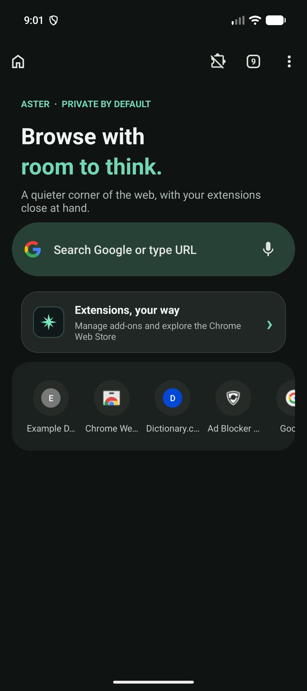
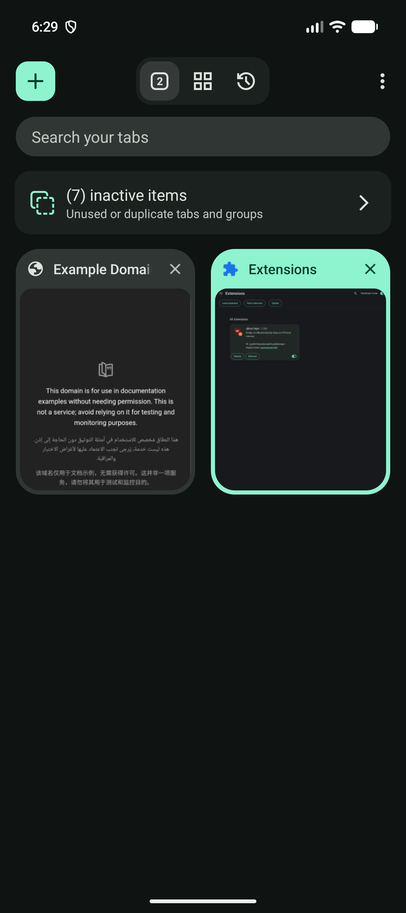
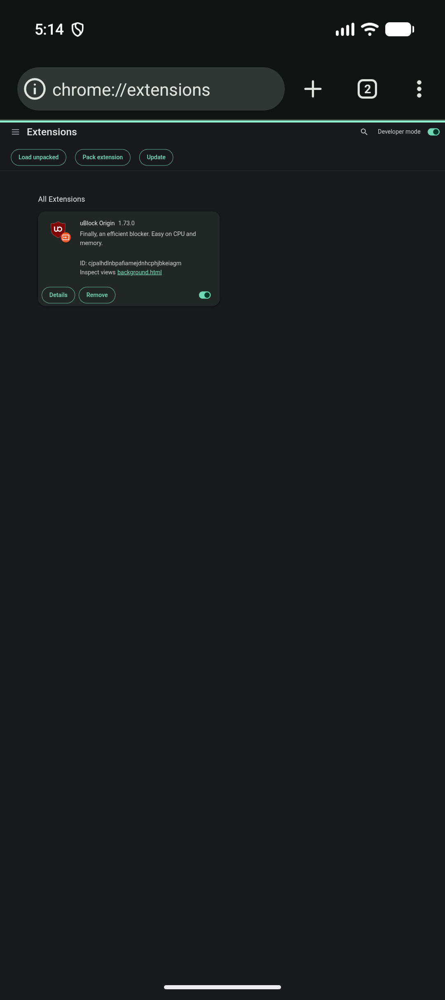
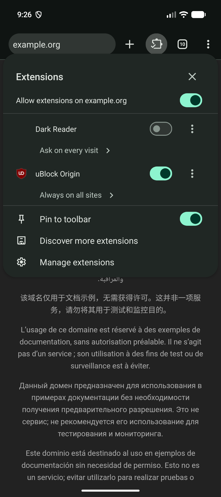

# Aster Browser v5.0.0

**Aster is one Android browser app with Chromium and GeckoView in the same package.** Switch engines inside the app; the tab URLs move with you. Each engine keeps its own cookies, extensions, permissions, and site profile.

> **v5 includes two CPU builds of the same app:** ARM64 for most Android phones and Quest-family devices, and x86_64 for emulator testing. It is not a separate Chromium APK and Gecko APK. The v5 GitHub release is currently a draft while its two APK assets are uploaded.

[Releases](https://github.com/B1progame/aster-browser/releases) · [Open issues](https://github.com/B1progame/aster-browser/issues) · [Roadmap](docs/ROADMAP.md)

## Screenshots and feature tour

These are real Android emulator captures of Aster UI and features. They are representative screenshots, not a claim that every feature shown was retested in the final v5 release pass. See the test notes below for current verification and gaps.

<table>
  <tr>
    <th>Home and quick launch</th>
    <th>Tab switcher</th>
    <th>Chromium extensions</th>
    <th>Per-site extension controls</th>
  </tr>
  <tr>
    <td></td>
    <td></td>
    <td></td>
    <td></td>
  </tr>
</table>

The app also has bookmarks/history views, engine-specific privacy controls, a local-AI interface, a Tor private-window entry, and settings for appearance and updates. Tor page rendering and AI inference have known gaps in this build; they are documented rather than represented as working in the screenshots.

## v5 download

When the draft is published, download the build matching the device's CPU from [GitHub Releases](https://github.com/B1progame/aster-browser/releases):

| APK | Device | What is inside |
|---|---|---|
| `AsterBrowser-v5.0.0-Android-arm64.apk` | ARM64 Android phones; Quest-family sideloading metadata | One app with Chromium and GeckoView |
| `AsterBrowser-v5.0.0-Android-x86_64.apk` | Android Studio x86_64 emulators | The same dual-engine app |

Verify the APK with [`dist/AsterBrowser-v5.0.0-SHA256SUMS.txt`](dist/AsterBrowser-v5.0.0-SHA256SUMS.txt). The ARM64 manifest declares Quest 3S, but no physical Quest 3S/controller test has been completed. The x86_64 build is the one exercised on the Pixel emulator.

## What is in v5

### Browser basics

- Search/address bar, navigation controls, home screen, multi-tab switcher, bookmarks, browsing history, and theme settings.
- Engine switching within one installed package and Android task. The tab URL list transfers; the engines do not share cookies, signed-in sessions, extension state, or all site data.
- Standard Android touch input. Quest support uses Android UI/controller input and does not require camera, eye, hand, or body tracking; Quest runtime behavior still needs a physical device test.
- Update-check and APK download flow in Settings. Updating from the published v2.2.0 release was not end-to-end tested for v5.

### GeckoView

- GeckoView browsing, signed Firefox WebExtensions, private tabs, tracking/fingerprinting/cryptomining protection, site permissions/data controls, and website-shredder controls.
- Firefox add-ons are a separate ecosystem from Chrome extensions; extensions do not convert automatically between engines.

### Chromium / Afterbird

- Chromium browsing and an experimental Android extension runtime with an extension manager, Chrome Web Store entry, and selected Manifest V3 extension support.
- Per-site extension access controls and Chromium-native browser settings/tools where implemented.
- The local-AI interface and a separate Tor private-window route are exposed in Chromium. In this v5 verification, the local model displayed Ready but returned no visible answer to a prompt within 90 seconds. Tor built a route, but pages timed out in the Chromium window.

### Privacy and diagnostics

- Privacy actions are engine-specific; a Gecko setting does not silently claim to change Chromium's network stack.
- The issue-report flow can attach a user-selected minimal crash/ANR summary. It excludes URLs, exception messages, raw logs, and browser data; it is not automatic telemetry.
- PC sharing remains marked **In development**.

## v5 verification status

On 2026-10-27, the x86_64 APK was installed on Android Studio's Pixel 10a emulator (Android 17). Chromium rendered `https://example.com/`. Switching Chromium → GeckoView → Chromium stayed in the same Android task, and GeckoView showed the transferred example.com URL. The tab switcher showed 14 Chromium tabs before a force-stop; 10 returned after relaunch, so full session restoration is not verified. No Aster fatal exception or ANR appeared in the tested launch/navigation/switch flow.

The ARM64 APK was built from the pinned Chromium checkout. Both APKs report package `app.aster.browser`, version 5.0.0, version code 805000000, and use the same signing certificate as v2.2.0. ARM64 was not exercised on phone/Quest hardware. Instagram Reels and YouTube desktop/fullscreen were not retested in this release pass.

**Known gaps:** Chromium Tor page rendering, AI prompt response, restoring every tab, update-from-v2.2.0, Quest 3S runtime/controller behavior, and full extension/API parity remain unverified or incomplete. GitHub issues [#1](https://github.com/B1progame/aster-browser/issues/1), [#2](https://github.com/B1progame/aster-browser/issues/2), and [#3](https://github.com/B1progame/aster-browser/issues/3) stay open. The app does not claim that every desktop Chrome extension works on Android.

Detailed results: [`docs/chromium-extension-engine.md`](docs/chromium-extension-engine.md) · Local AI limits: [`docs/ON_DEVICE_AI.md`](docs/ON_DEVICE_AI.md) · Planned work: [`docs/ROADMAP.md`](docs/ROADMAP.md)

## Next features

The first proposed feature is **import from another browser**. Android apps cannot normally read another browser's private history database, so Aster should use the Android file picker for exported bookmarks/history (for example, Netscape HTML or supported JSON), show a preview, let the user choose Gecko or Chromium, and deduplicate before importing. The full proposal and other priorities are in the [roadmap](docs/ROADMAP.md).

Other proposed work includes reliable cross-engine tab/session recovery, a tested on-device assistant in both engines, Chromium Tor page rendering with fail-closed behavior, an extension compatibility matrix, and a reviewed Android-to-PC handoff.

## Build from source

Open the repository in Android Studio with the configured JDK 17 and Android SDK. `:app:assembleDebug` builds the GeckoView-only development variant. The combined package requires the pinned full Chromium checkout and integration pipeline:

```bash
chromium-engine/afterbird-source/ci/chromium_android_pipeline.sh --full-build
```

The checked-in `chromium-engine/afterbird-source/` directory is an integration overlay and patch set, not a full Chromium source checkout. Build dependencies and setup are described in that directory's documentation. H.264/AAC distribution may be subject to patent and licensing restrictions.
